  

 

### 🚀 Shipped @ [Ventra Rocket](https://github.com/ventra-rocket)

| Project | What it does |
|---|---|
| [**EchoSEO**](https://github.com/ventra-rocket/EchoSEO) | Open-core, self-hostable Semrush/Ahrefs alternative — audits that verify their own fixes, agent-native MCP workspace on Cloudflare Workers |
| [**Kello**](https://github.com/ventra-rocket/Kello) | B2B data API + consumer hub for the luxury-watch market — unified specs, market listings, price history; Nuxt 3 · Laravel 13 · Postgres · Redis |
| [**SpeakHub**](https://github.com/ventra-rocket/speakhub) | Booking · payment · AI placement-test platform for an offline English speaking club — multi-branch ops, Postgres RLS |

 

- **langs** · TypeScript · Go · Python · PHP
- **ui** · React · Next.js · Vue/Nuxt · Tailwind
- **ops** · Postgres · Redis · Docker · Kubernetes · Cloudflare Workers

<picture>
  <source media="(prefers-color-scheme: dark)" srcset="https://raw.githubusercontent.com/QuocHuannn/QuocHuannn/output/github-contribution-grid-snake-dark.svg" />
  
</picture>
